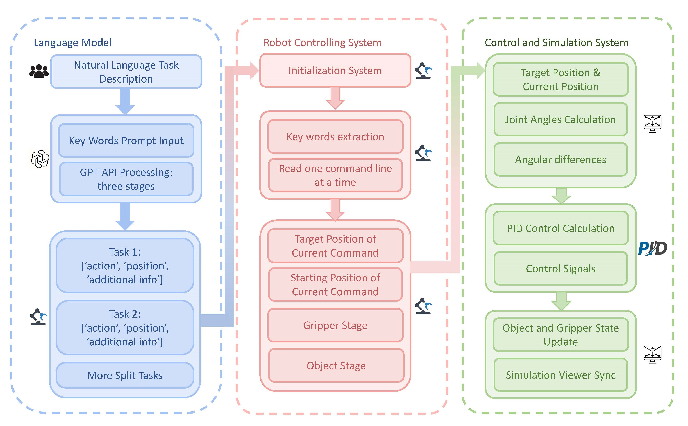
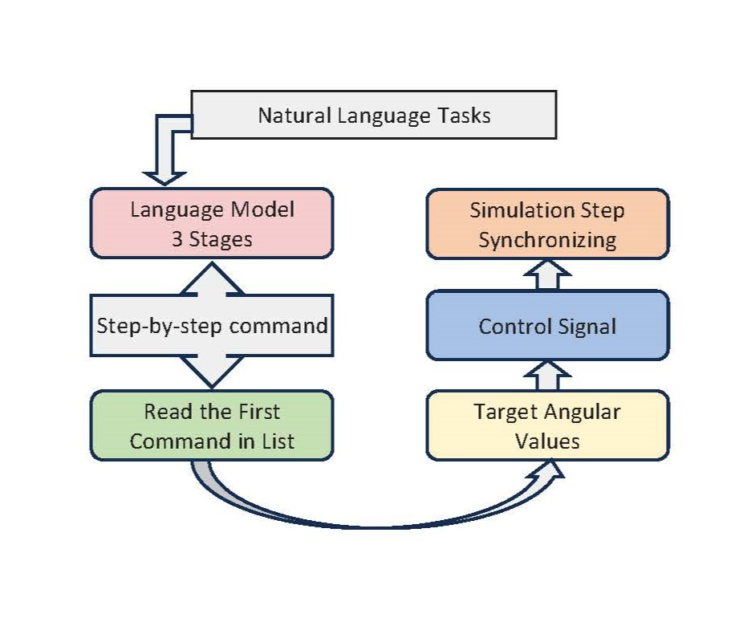
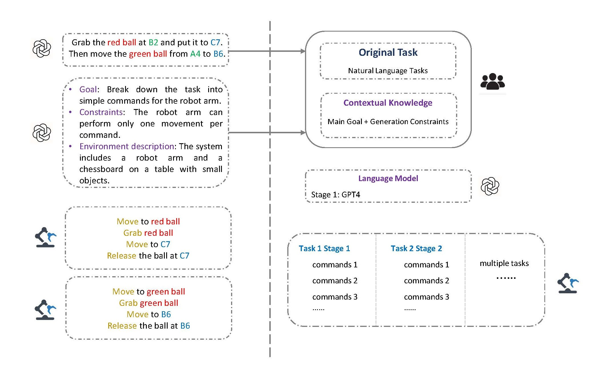
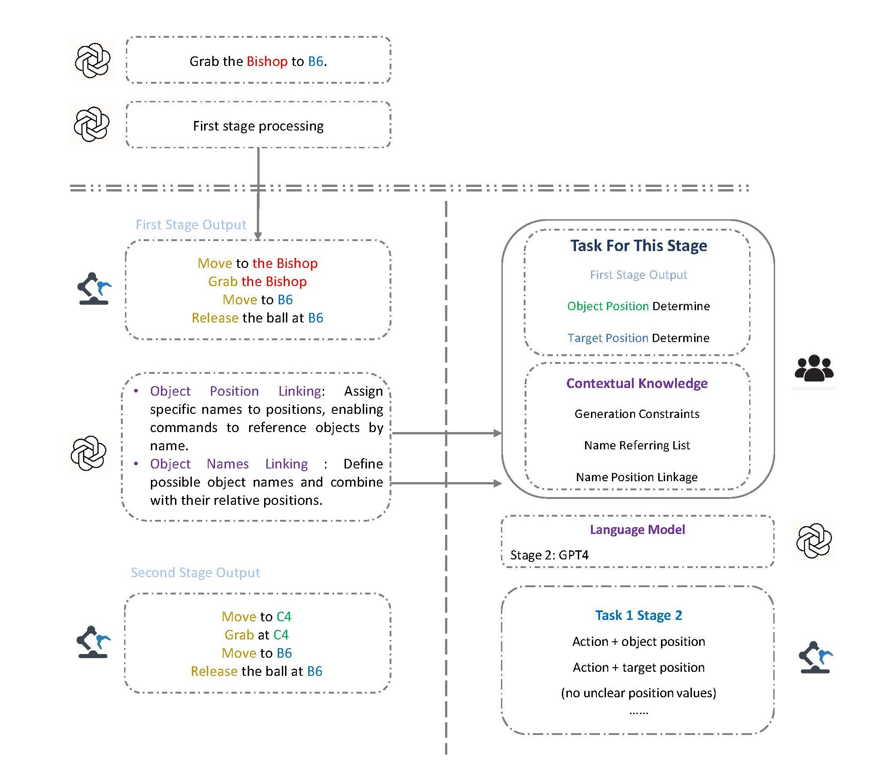
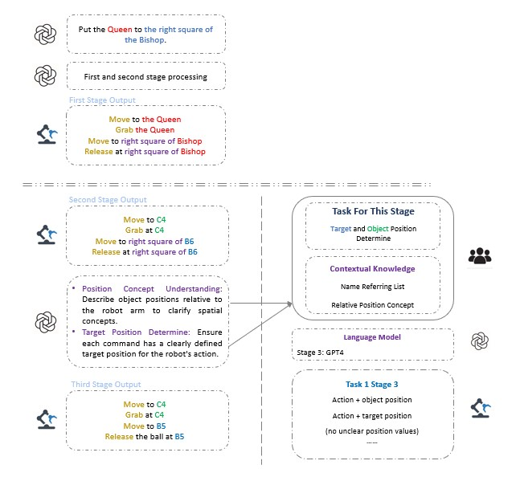
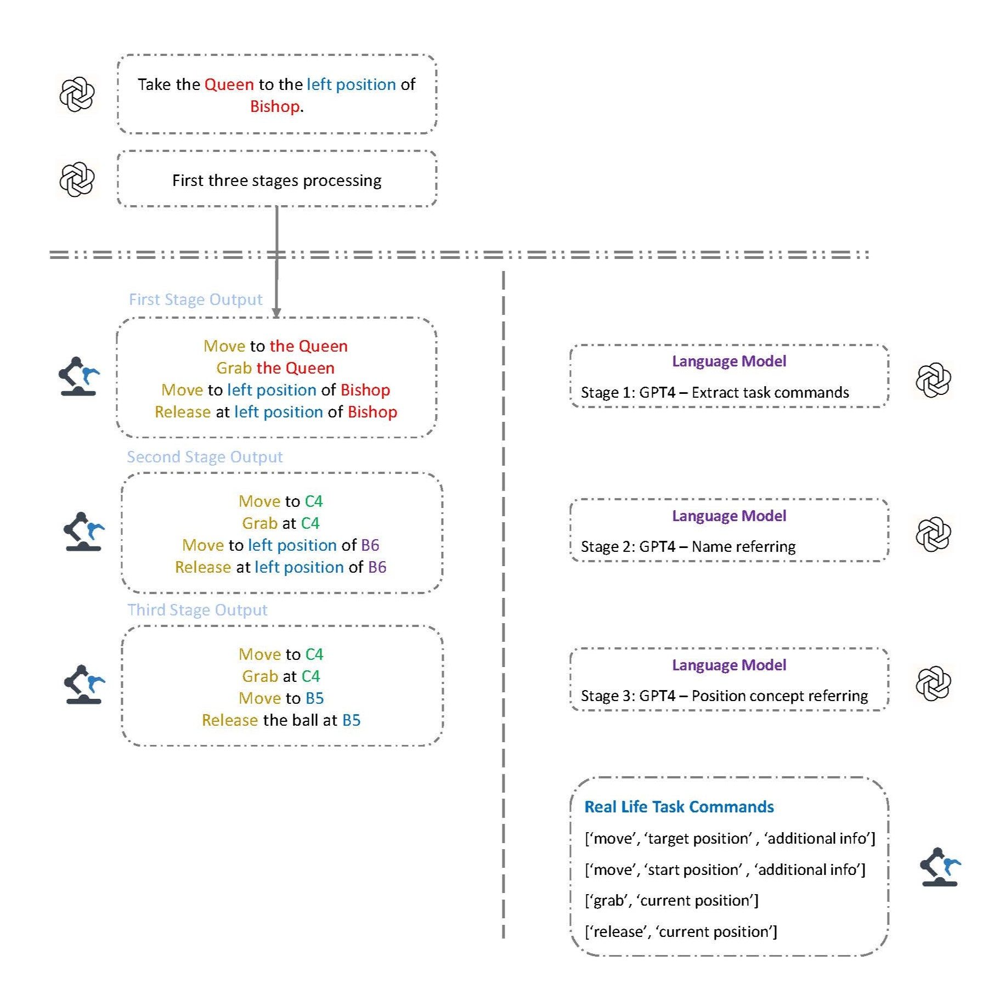

# 大規模言語モデルを用いたロボット制御

## 📚 このドキュメントを他の言語で読む

- [🇺🇸 English](../README-EN.md)  
- [cn 中文](../files/README.md)  
- [🇯🇵 日本語](../files/README-JP.md)  

プロジェクトの構成は次の図の通りです：



プロジェクトはハード部分とソフト部分の2つに分かれています。ハード部分はロボットアーム制御部分で、ロボットアームの制御を担当します。ソフト部分は言語モデル部分で、指示の生成を担当します。

言語モデル部分にはOpenAIのGPT-4モデルを使用しています。本モデルはロボットアームの指示を生成し、生成された指示はロボットアーム制御部分に送られてロボットアームの制御に使用されます。

言語モデルの4つのステージは以下の通りです：



第一ステージでは、指示を複数の小さなパートに分割します。



第二ステージでは、自然言語の指示内での名称参照を明確化します。以下の例では、「queen」という指示がB6の駒を指していることを示します。



第三ステージでは、自然言語の指示内での位置参照を明確化します。以下の例では、「right square of B6」という指示がB5の位置を指していることを示します。



最終ステージでは、全体の論理と指示の一貫性を最終チェックします。



# プロジェクト環境のセットアップ

このドキュメントでは、プロジェクト環境のセットアップ手順を説明します。

## 前提条件

- Python 3.8以上  
- mujoco 210（最新バージョン）  
- mujoco-pyではなくmujocoのみを使用  
- mamba（任意ですが推奨）  

## インストール

1. **リポジトリをクローン：**

    ```sh
    git clone https://github.com/zniihgnexy/niryo_project.git
    cd niryo_project
    ```

2. **仮想環境を作成：**

    ```sh
    mamba env create -f mamba_mujoco_base.yml
    ```

3. **仮想環境を有効化：**

    ```sh
    conda activate mujoco
    ```

4. **必要なパッケージをインストール：**

    ```sh
    pip install -r requirements.txt
    ```

## シミュレーションデモの実行

**単一指示および複数指示用のシミュレーションスクリプトを実行：**

```sh
python main_simulation.py
python main_simulation_multi.py
```
これらはシミュレーションの例示用動画です。最初の動画は単一指示による移動タスクのロボットシミュレーションで、二つ目の動画は複数指示による複雑なロジックのシミュレーションです。

以下の動画をご覧ください：

**単一指示：** この動画では、入力コマンドが「move the queen to C2」です。ロボットは小さな緑色のボール（B6のqueen）をC2のマスに移動させます。

https://github.com/user-attachments/assets/400ba2c1-fa2e-46e6-ac44-b870bc80d0c0

**複数指示：** この動画では、入力コマンドが「move the queen to its further square and move the pawn to its diagonal square」です。ロボットはqueen（B6のボール）をC6のマスに、pawn（B3のボール）をC2のマスに移動させます。

https://github.com/user-attachments/assets/71c3d2f9-7d9a-4fef-a84f-e60a670d1be6

## 言語モデルに関する注意事項
本実験はGPT-4言語モデルに基づいているため、APIキーが必要です。llmAPI/api.pyファイル内に自身のAPIキーを設定してください。（APIキーはhttps://beta.openai.com/account/api-keysから取得可能です）

現在、apiファイルはアップロードされていません。

## プロジェクト構成
プロジェクト構成は以下の通りです：
